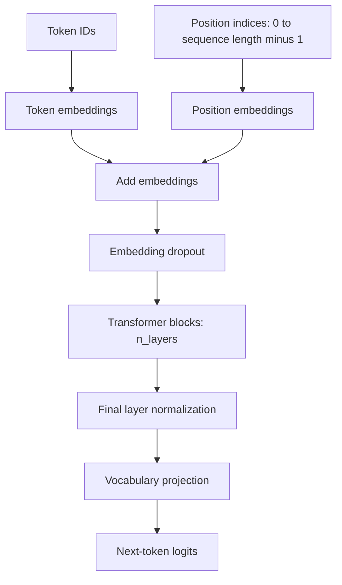
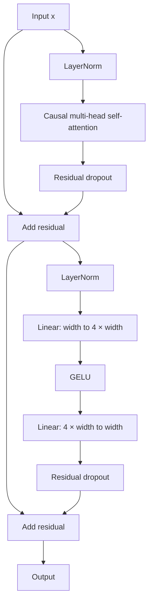

# GPT-2 model

`llm_training.model.gpt2` is the decoder-only, GPT-style Transformer that the next-token
`train` command trains from scratch. The other model family, Qwen3, is described in
[the Qwen3 guide](qwen3.md). The implementation follows the explicit architecture in Sebastian
Raschka's *LLMs-from-scratch*, with project-specific module organization. It
uses GPT-2's tokenizer and vocabulary. New training runs initialize embedding
and linear weights from scratch: by default with PyTorch's defaults (`model.init:
pytorch`, the book recipe), or with GPT-2-style N(0, 0.02) initialization
(`model.init: gpt2`, see below); layer normalization starts with scale 1 and
shift 0. Resumed runs restore the saved parameters. `model.init_from` starts instead from
OpenAI's released GPT-2 small or medium weights (see the
[fine-tuning guide](finetuning.md)), which the `pytorch`/`gpt2` initialization then does not
affect.

The [architecture explorer](https://bwu1234.github.io/llm-training/) ([local copy](architecture/index.html)) shows every preset's modules and
each tensor step, with shapes, parameter counts and source, side by side with Qwen3.

## Data flow

For an input sequence of token IDs, the model performs these steps:

1. **Token and position embeddings.** Each token ID is mapped to a learned
   vector of width `emb_dim`. A learned position embedding for each sequence
   position is added to it. Positions are integer indices from 0 to the sequence
   length minus 1, generated independently of token values. Embedding dropout is
   then applied.
2. **Transformer blocks.** The sequence passes through `n_layers` blocks with
   the same structure and separate parameters. Each block applies
   pre-normalized causal multi-head self-attention, adds a residual connection,
   then applies pre-normalized feed-forward layers
   with GELU and another residual connection. Residual dropout is used after
   each sublayer.
3. **Output normalization and vocabulary projection.** A final layer
   normalization is followed by a linear projection to `vocab_size` logits for
   every input position.

The input has shape `[batch, sequence length]`; hidden states have shape
`[batch, sequence length, emb_dim]`. The output has shape
`[batch, sequence length, vocab_size]` and contains raw logits. Training uses
cross-entropy with targets shifted one token ahead: the logits at position `t`
predict token `t + 1`. Causal masking allows access to tokens through `t`,
including the token at `t`, while blocking later positions.

Each block uses two pre-normalized sublayers with residual connections:

## Attention and block details

Each attention layer projects the hidden states separately into queries, keys,
and values. The projections are split into `n_heads` heads, each of width
`emb_dim / n_heads`. Each head computes `Q @ K.transpose(-2, -1)` and scales
the scores by `1 / sqrt(head_dim)`. A causal mask sets future-position scores to
negative infinity before softmax, so those positions receive zero attention
weight. Softmax normalizes over key positions up to and including the current
position. Attention-probability dropout is applied to those weights before
multiplication by the values. The head outputs are joined and passed through
an output projection, followed by the block's residual dropout shown above.

Layer normalization is applied before each attention or feed-forward sublayer.
The feed-forward network expands each token representation to `4 * emb_dim`,
applies the tanh approximation of GELU, then projects back to `emb_dim`.
The first residual adds the block input to the attention sublayer output;
the second adds that intermediate result to the feed-forward sublayer output.
Layer normalization operates across the embedding dimension for each token,
with learned scale and shift and `eps=1e-5`.

By default the token embedding and output projection are **untied**: they are
separate parameter matrices. `model.tie_embeddings: true` shares one matrix, as in GPT-2. The output projection has no bias. Query, key, and value
projections have no bias when `qkv_bias: false`, as in the presets. The attention
output projection and both feed-forward linear layers include biases.
`drop_rate` controls embedding, attention-probability, and residual dropout;
both presets use 0.1. Dropout is disabled in evaluation mode.

## Preset sizes

| Preset | Context | Width (`emb_dim`) | Layers | Heads | Vocabulary | Parameters |
| --- | ---: | ---: | ---: | ---: | ---: | ---: |
| [Smoke](../configs/smoke.yaml) | 16 | 32 | 2 | 4 | 50,257 | 3,242,240 |
| [GPT 162M pretraining](../configs/pretrain_gpt_162m.yaml) | 256 | 768 | 12 | 12 | 50,257 | 162,419,712 |
| [GPT-2 small recipe](../configs/pretrain_gpt2_124m.yaml) | 1,024 | 768 | 12 | 12 | 50,257 | 124,439,808 |

The heads have width 8 in the smoke preset and 64 in the GPT 162M preset.
Context length, embedding width, layer count, head count, dropout, and QKV bias
are configuration values; `emb_dim` must be divisible by `n_heads`.
The vocabulary size is currently fixed to 50,257 by the GPT-2 tokenizer
contract.

`sequence length` must not exceed `context_length`, which sizes both the learned
position table and the causal mask. The model forward pass does not crop inputs.
The generation helper crops to the most recent context window and recomputes
the forward pass for each new token, assigning positions from 0 within that
window. It does not cache keys and values.

## Relationship to GPT-2

The GPT 162M preset shares GPT-2 small's 12 layers, 12 heads, and embedding width
of 768. Its context length, parameter sharing, QKV bias, and initialization differ.
The [GPT-2 small recipe](#gpt-2-small-recipe) closes those differences.
Its logits match the public GPT-2 124M weights loaded into this model (see
[GPT-2 initialization and weights](#gpt-2-initialization-and-weights)). Comparison for the
162M book preset:

| Setting | This project's GPT 162M preset | Original GPT-2 small |
| --- | --- | --- |
| Context length | 256 | 1,024 |
| Token embedding and output weights | Separate matrices (untied) | Shared matrix (tied) |
| Query, key, and value biases | Disabled | Enabled |
| Weight initialization | PyTorch defaults (embeddings N(0,1)) | N(0, 0.02); position table N(0, 0.01); zero biases |
| Parameters | 162,419,712 | 124,439,808 |

These GPT-2 settings are defined in
[OpenAI's original implementation](https://github.com/openai/gpt-2/blob/master/src/model.py).
The separate output matrix alone contributes 38,597,376 parameters in this
project's larger preset. The 162,419,712 total reflects this implementation and
configuration; it should not be read as the parameter count of original GPT-2
small. Enabling QKV bias, tying the head, and using context 1024 gives 124,439,808.
Training-recipe differences (weight-decay groups, betas, schedule, clipping) and
the plan to close all gaps are in the [GPT-2 parity gap register](gpt2-parity-gaps.md).

## GPT-2 small recipe

[`configs/pretrain_gpt2_124m.yaml`](../configs/pretrain_gpt2_124m.yaml) is GPT-2 small
(**124,439,808 parameters**: tied head, QKV bias, context 1024) with nanoGPT's optimization
recipe. Each piece is a config field whose default keeps the book behavior:

| Field | GPT-2 recipe | Book default |
| --- | --- | --- |
| `model.init`, `residual_scaled_init` | `gpt2`, `true` | `pytorch` |
| `model.tie_embeddings` | `true` | `false` |
| `model.attn_impl` | `sdpa` (fused) | `explicit` |
| `training.weight_decay_policy` | `matrices` (no decay on biases/LayerNorm) | `all` |
| `training.beta1`, `beta2` | 0.9, 0.95 | 0.9, 0.999 |
| `training.lr_schedule`, `warmup_steps`, `min_lr` | cosine, linear warmup | constant |
| `training.grad_clip` | 1.0 (global norm) | none |
| `training.grad_accum_steps` | micro-batches per update | 1 |

`batch_size` is the micro-batch; one optimizer update averages `grad_accum_steps` of them, so
tokens per update are `batch_size x context_length x grad_accum_steps`. A final partial group at
the end of an epoch still updates, averaged over the micro-batches it has. The learning rate is
a pure function of the update index, so resume does not depend on optimizer state. Metrics now
include the pre-clip `grad_norm`.

The preset's **data path, tokens per update (32,768, against nanoGPT's ~0.5M scale), warmup
length, token budget, and evaluation cadence are provisional**: no corpus is selected yet, so `prepare` reports the data file missing. The
model/recipe pieces are verified by unit tests, an exact fresh-process resume test with every
feature active, an accumulation-equals-full-batch test, and the pretrained-weight oracle in
[GPT-2 initialization and weights](#gpt-2-initialization-and-weights).

## GPT-2 initialization and weights

`model.init: gpt2` draws every `nn.Linear` and `nn.Embedding` weight from N(0, 0.02)
and zeroes biases, as in nanoGPT. With `model.residual_scaled_init: true` (the default
when `init: gpt2`), the two projections that write into the residual stream (attention
output and the feed-forward's second layer) use `0.02 / sqrt(2 * n_layers)`, following
the GPT-2 paper's description. OpenAI's released code applies neither the scaling nor
nanoGPT's 0.02 for the position table (it uses 0.01); set `residual_scaled_init: false`
to drop the scaling. Tying requires `init: gpt2`: a shared matrix between PyTorch's
N(0, 1) embedding and a default-scaled head would start with a badly scaled head.

`tests/reference/gpt2_weights.py` maps the public Hugging Face GPT-2 weights into this
model (projections are transposed; `c_attn` is split into Q/K/V). It is a test oracle only:
training code never imports it. Fine-tuning loads the author's converted files instead
(`model/gpt2/pretrained.py`); `tests/oracle/test_gpt2_lineage.py` uses this mapping to show
the small file is bit-identical to OpenAI's release. `LLM_ORACLE=1 uv run --group oracle pytest tests/oracle`
downloads about 550 MB once. On 1,024-token inputs it matched Hugging Face to a maximum
absolute logit difference of 1.4e-4 at logit magnitudes up to about 100 (relative
about 1.4e-6), with identical argmax at every position; a deliberately broken mapping
differs by 61.5.

## Implementation map

- [`gpt2/model.py`](../src/llm_training/model/gpt2/model.py): embeddings, Transformer block,
  final normalization, and GPT model forward pass.
- [`gpt2/attention.py`](../src/llm_training/model/gpt2/attention.py): causal multi-head
  self-attention and masking.
- [`gpt2/layers.py`](../src/llm_training/model/gpt2/layers.py): layer normalization,
  GELU, and feed-forward network.
- [`gpt2/init.py`](../src/llm_training/model/gpt2/init.py): GPT-2-style initialization
  (`model.init: gpt2`).
- [`gpt2/tokenizer.py`](../src/llm_training/model/gpt2/tokenizer.py): pinned GPT-2
  tokenizer assets and the `tiktoken` encoding.
- [`gpt2/pretrained.py`](../src/llm_training/model/gpt2/pretrained.py): pinned OpenAI GPT-2
  small and medium weights for `model.init_from`.
- [`gpt2/family.py`](../src/llm_training/model/gpt2/family.py): the recipe's `model` settings
  (`GPT2ModelConfig`), their validation, and how the trainer builds, loads and tokenizes
  GPT-2 (see [adding a model family](how-to/add-a-model-family.md)).
- [`dataset.py`](../src/llm_training/data/dataset.py) and
  [`loss.py`](../src/llm_training/lm/loss.py): shifted next-token targets
  and cross-entropy loss.
- [`generation.py`](../src/llm_training/lm/generation.py): context cropping and
  greedy token generation.

See also the [upstream provenance notes](upstream-provenance.md) and the
[chapter reproduction report](experiments/chapter-reproduction.md) for
implementation lineage and parity evidence.
