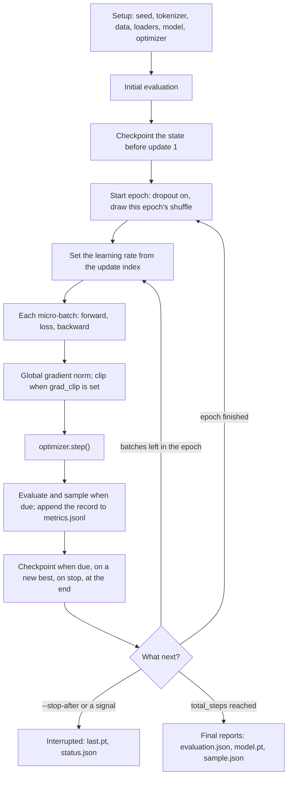

# Training loop

This guide covers the next-token trainer, [`lm/trainer.py`](../src/llm_training/lm/trainer.py)
(`llm-training train`). Pretraining, continued pretraining and SFT all run through it. It also
explains [the evaluation metrics](#evaluation-metrics) a run reports. GRPO has its own loop,
contrasted [at the end](#grpo-differs). For stopping, resuming and what a checkpoint holds, see
[Stop and resume](../README.md#stop-and-resume). For the files a run writes, see
[Run artifacts](../README.md#run-artifacts).

## Setup, before any update

`Trainer.__init__` does everything that can fail before a run directory exists. Model
initialization and data shuffling draw from the same seeded RNG streams, so the order is fixed:

1. On resume, restore the recipe from the checkpoint and reject a changed environment or code
   (see the README).
2. Seed Python, NumPy and Torch with `training.seed`.
3. Load the tokenizer, then the train and validation datasets. Text and token corpora are cut
   into non-overlapping windows of `data.max_length` tokens (`model.context_length` when it is
   null). Instruction data is one example per item.
4. Build the loaders. Training shuffles and drops the last partial batch. Validation keeps
   file order and every window. Both use `num_workers=0`.
5. Build the model, load `model.init_from` if set, and move the model to the device.
6. Build AdamW ([`lm/optim.py`](../src/llm_training/lm/optim.py)). With
   `weight_decay_policy: all` it is one group over all parameters, as in the book. With
   `matrices`, tensors with 2 or more dimensions decay and biases and LayerNorm do not.
7. Compute the update budget:
   `total_steps = ceil(len(train_loader) / grad_accum_steps) x num_epochs`, capped by
   `max_steps`.
8. On resume, load the weights, AdamW state, history, best validation loss and RNG state.

`Trainer.run` then measures the **initial evaluation**. A resumed run reuses its parent's
instead. `run` creates the run directory and writes a checkpoint of the state before the first
update, so a failure in update 1 still leaves a valid `last.pt`. A resumed run first copies
its parent's history into its own `metrics.jsonl`.

## Epochs

`run` calls `_train_epoch` until the update count reaches `total_steps`. Each epoch starts
with `model.train()`, which turns dropout on when the model has any. `_epoch_iterator` then
saves the RNG state and creates the loader's iterator. That draws the epoch's shuffle order
from the training RNG. Anything that draws from that RNG earlier therefore changes the order,
including `sampled_train_validation`'s monitoring.

On resume in the middle of an epoch, `_epoch_iterator` does the following:

1. It restores the RNG state saved at the start of the epoch.
2. It draws the same order again and skips the `batch_cursor` batches already trained on,
   without running the model on them.
3. It restores the live RNG state.

The next batch is then the one an uninterrupted run would have used.

## One update

`Trainer.step` does one optimizer update over one group of micro-batches:

1. **Learning rate.** Unless the schedule is constant, it sets every parameter group's rate
   from the update index (see [Learning-rate schedule](#learning-rate-schedule)). It never
   reads the rate back from the optimizer.
2. `optimizer.zero_grad()`.
3. **Micro-batches.** The group is `min(grad_accum_steps, batches left in the epoch)`, so a
   group never crosses an epoch boundary, and the last group of an epoch can be short. For each
   micro-batch:
   - forward pass and mean cross-entropy over targets that aren't `-100`
     ([`lm/loss.py`](../src/llm_training/lm/loss.py));
   - if the loss is not finite, stop with an error, before `backward`;
   - `backward()` on `loss / group` (on `loss` when the group is 1, as in the book).
4. **Gradient norm and clipping.** `clip_and_measure`
   ([`training/gradients.py`](../src/llm_training/training/gradients.py)) computes the global
   L2 norm once. If `grad_clip` is set and the norm is finite, it scales the gradients down to
   that norm. If the norm is not finite, the run stops with an error and the optimizer never
   steps. This one check replaces a per-parameter `isfinite` scan.
5. `optimizer.step()`, then advance the counters: completed updates, the batch cursor within
   the epoch, and supervised tokens seen.

`grad_clip` defaults to null, so the book recipe never clips. When it is set, it applies to
every update, warmup included, as in nanoGPT. Appendix D of *Build a Large Language Model
(From Scratch)* clips only after warmup.

Text and token windows are all full, and the training loader drops the last partial batch, so
the mean of micro-batch means equals the token-weighted mean. Instruction batches hold
different numbers of supervised tokens, so they require `grad_accum_steps: 1`
([fine-tuning guide](finetuning.md#instruction-data)).

## After each update

`Trainer._train_epoch` runs these in order:

1. **Monitoring** (`_monitor`) after updates 1, 1 + `eval_freq`, 1 + 2·`eval_freq`, ...
   (counting from 1; the README's 162M section counts the same points from 0):
   - `recipe: validation_only` takes the token-weighted loss over the first `eval_iter`
     validation batches, under isolated RNG, with dropout off.
   - `recipe: sampled_train_validation` (the book's loop) takes the unweighted mean of batch
     losses over `eval_iter` batches of the shuffled training loader and of the validation
     loader. Building the training iterator draws from the training RNG, exactly as the source
     does. This is deliberate: it keeps `pretrain_gpt_162m.yaml` at parity with chapter 5.
   - A lower validation loss than any before marks the update as the new best. The loss
     compared is the one the recipe reports.
2. **Sample.** If `output.sample_every` is set, a sample is added after updates 1,
   1 + `sample_every`, ... (see [Samples](#samples)).
3. **End of epoch.** When the cursor reaches the end of the loader, `_end_epoch` resets the
   cursor. Under `sampled_train_validation` it also takes an end-of-epoch sample, as the book
   does. Those samples are kept in memory and in checkpoints, and written to
   `epoch-samples.jsonl` when the run ends.
4. **Checkpoint.** It writes `checkpoints/last.pt` when the update count is a multiple of
   `checkpoint_every`, on a new best, on a stop request, and at the end of the budget. On a new
   best it also copies `last.pt` to `best.pt`. Early in training most evaluations are a new
   best, so most evaluations also write a checkpoint. A Qwen3 `last.pt` is about 9 GB.
5. **Stop check.** Training stops when the count reaches `--stop-after`, after SIGINT or
   SIGTERM, or when it reaches `total_steps`.

The two counts are offset by one. TinyStories sets `eval_freq` and `checkpoint_every` to 250,
so it evaluates after updates 1, 251, 501, ... and checkpoints after 250, 500, ...

## Learning-rate schedule

[`lm/schedule.py`](../src/llm_training/lm/schedule.py) gives the rate as a pure function of
`k`, the number of updates already completed (`k = 0` for the first update). With peak
`learning_rate`, warmup `W` and budget `N = total_steps`:

| Update index | Rate |
| --- | --- |
| `k < W` (linear warmup) | `peak x (k + 1) / (W + 1)` |
| `k >= W`, `lr_schedule: constant` | `peak` |
| `k >= W`, `lr_schedule: cosine` | `min_lr + 0.5 x (1 + cos(pi x (k - W) / (N - W))) x (peak - min_lr)` |

- The schedule is skipped only when it is `constant` with `warmup_steps: 0`, the book's
  recipe. `constant` with warmup ramps up, then stays flat.
- Warmup follows nanoGPT. It starts at `peak / (W + 1)`, not at zero, and reaches `peak` at
  the first update after warmup.
- Cosine reaches `min_lr` at `k = N`, which is one past the last update. The final update
  runs slightly above `min_lr`.
- `max_steps` changes `N` and so the cosine length. `--stop-after` doesn't: a run stopped
  early is left partway down the curve, ready to resume. Treat `--stop-after` as a pause. A
  run you never resume ends at a high rate and misses the low-rate finish, which usually
  lowers the loss at the end. To end a run early for good, set `max_steps` before starting.
  The recipe can't change on resume, so the budget can't be shortened later.
- With `warmup_steps > 0`, warmup must be shorter than `N`.

## Records in `metrics.jsonl`

One JSON line per update:

| Field | Meaning |
| --- | --- |
| `optimizer_step` | completed updates, counting this one (1-based) |
| `epoch` | epoch this update belongs to (1-based) |
| `train_loss` | mean of the group's micro-batch losses, measured before this update's step |
| `tokens_seen` | cumulative supervised target tokens (targets that aren't `-100`) |
| `learning_rate` | rate this update used |
| `grad_norm` | global gradient norm before clipping |
| `batch_sha256` | hash of the group's input tokens, which the resume tests compare |
| `validation` | on monitored updates under `validation_only`: `loss`, `perplexity`, `tokens` |
| `source_train_loss`, `source_val_loss` | on monitored updates under `sampled_train_validation` |
| `sample` | on sampled updates: the generated text |

## Samples

Samples come from `output.prompt`, `output.sample_tokens` long:

- `output.temperature: 0` with no `top_k` is greedy. That is the book's text loop, and for
  instruction data it stops at end-of-text.
- Otherwise the sample is drawn with a private generator seeded from `(seed, update)`. It
  never draws from the training RNG, so turning samples on or off doesn't change training.

The same settings apply to `sample_every`, end-of-epoch and final samples. The TinyStories
and continued-pretraining presets sample at temperature 0.8 with top-k 50.

## The end of a run

- **Completed** (the update count reaches `total_steps`). `_write_final_reports` writes:
  - `evaluation.json`: the initial and final monitored subsets, plus the full validation split;
  - `model.pt`: weights and model config, the hand-off to `init_from`, `predict` and
    `generate`;
  - `sample.json`: one final sample.
- **Interrupted** (`--stop-after` or a signal). It writes `last.pt`, `epoch-samples.jsonl` and
  `status.json`, but no `model.pt`, `evaluation.json` or `sample.json`. Resume to finish, or
  point `generate` or `predict` at the checkpoint.
- **Failed** (any exception, including a non-finite loss or gradient). `status.json` records
  `failed`, the error, and `recovery_checkpoint: checkpoints/last.pt`. Half-applied state is
  never saved, so resume from that checkpoint.

## Evaluation metrics

To see them for a run, write its page with the [run viewer](../README.md#run-viewer).

Every loss here is a cross-entropy in **nats per target token**: the average of
`-ln p(correct next token)`. Lower is better. A model that spreads probability evenly over the
vocabulary scores `ln(vocab_size)`, about 10.82 for GPT-2's 50,257 tokens. Perplexity is
`exp(loss)`: roughly the number of equally likely tokens the model is choosing among.
It is reported as `null` when the loss is too large for `exp` (709 or more).

### During training

| Metric | Measured on | How to read it |
| --- | --- | --- |
| `train_loss` | the update's own batches, before its step, in training mode | Noisy: one group per point, with dropout on when the model has it. Read the trend, not single values. |
| `validation.loss` (`validation_only`) | the first `eval_iter` validation batches, in file order, dropout off, weighted by token | The same batches every time, so points within a run compare exactly. This loss picks `best.pt`. |
| `source_val_loss` (`sampled_train_validation`) | the same validation batches, as an unweighted mean of batch means | The book's number. It differs from the token-weighted loss when batches hold different token counts: a partial last batch, padding, or masked prompts. |
| `source_train_loss` | `eval_iter` freshly shuffled training batches | A different subset at every evaluation. A widening gap below `source_val_loss` means overfitting, as on chapter 5's small text. |
| `grad_norm` | the whole model's gradient | Spikes point to instability. With `grad_clip` set, values above it were scaled down before the step. |
| `learning_rate` | the schedule | Use it to check warmup and decay against the losses. |
| `tokens_seen` | supervised targets so far | Use it as the x-axis to compare runs with different batch or accumulation sizes. |

### At the end: `evaluation.json`

| Key | Measured on | Use |
| --- | --- | --- |
| `initial` | the monitored subset, before any update (a resumed run keeps its parent's) | Baseline. Near `ln(vocab_size)` from random init; the starting model's loss for `init_from`. |
| `final` | the same subset, after the last update | `initial` minus `final` is what training gained on the same tokens. |
| `full_validation` | the whole validation split, after the last update | The number to report and to compare runs on. |

The completed TinyStories run (`tinystories_51m.yaml`, 14,155 updates):

| | Loss | Perplexity | Tokens |
| --- | --- | --- | --- |
| `initial` | 10.966 | 57,864 | 163,840 |
| `final` | 1.317 | 3.73 | 163,840 |
| `full_validation` | 1.383 | 3.99 | 4,666,880 |

The monitored subset is the first 20 validation batches in file order (3.5% of the split), not
a random sample. Here it scores 0.07 nats lower than the full split. Use it for the trend
within a run, and `full_validation` for comparisons between runs.

### Caveats when comparing

- **Tokenizers.** Loss is per token, so GPT-2 and Qwen3 losses on the same text are not on the
  same scale: their tokens differ.
- **Prompt masking.** With `mask_prompt: true` only response tokens count, so its losses don't
  compare with unmasked runs.
- **Best versus final.** `best.pt` is chosen on the monitored subset. `full_validation`
  evaluates the last model, not the best one.
- **Recipe.** `validation_only` and `sampled_train_validation` losses come from different
  formulas. Compare runs only within one recipe.

### GRPO and MATH-500

GRPO's `metrics.jsonl` has one record per step. `reward_mean` is the fraction of that step's
rollouts graded correct, on one training problem. It is very noisy and is not a test score.
`zero_advantage` marks steps where every rollout earned the same reward, so the gradient was
zero. `mean_gen_len` and `hit_token_limit` show answer length; a rise in `hit_token_limit`
means answers are being cut off. See the [GRPO guide](grpo.md#run-directory).

`math-eval` writes one JSONL record per problem:

- `extracted`: the answer taken from the text;
- `correct`;
- `gen_tokens` and `hit_token_limit`;
- `grader_issue`, for example a timeout.

It also writes a `.summary.json` file next to the records, with `accuracy`, `mean_gen_tokens`,
the number of answers that hit the token limit, and the number of grader issues. An answer cut
off at the limit usually has no final `\boxed{}` and counts as wrong. `accuracy` is the number
to choose a snapshot by.

## GRPO differs

`grpo-train` ([`reasoning/trainer.py`](../src/llm_training/reasoning/trainer.py)) shares the
clipping helper, the atomic checkpoint writer, the config hash, and the stop and resume
conventions. Each step:

- takes one MATH problem in file order. There are no epochs or batches.
- samples `num_rollouts` answers, grades them, and backpropagates each rollout's loss
  separately ([GRPO guide](grpo.md#recipe));
- clips and steps at a constant learning rate, with no schedule. With
  `skip_zero_advantage_updates: true`, it skips the step when every rollout earned the same
  reward.

Snapshots (`snapshot_every`, weights only, kept) are separate from `checkpoints/last.pt`
(`checkpoint_every`, full state, overwritten). The step loop runs no evaluation;
`math-eval` scores snapshots afterwards.
